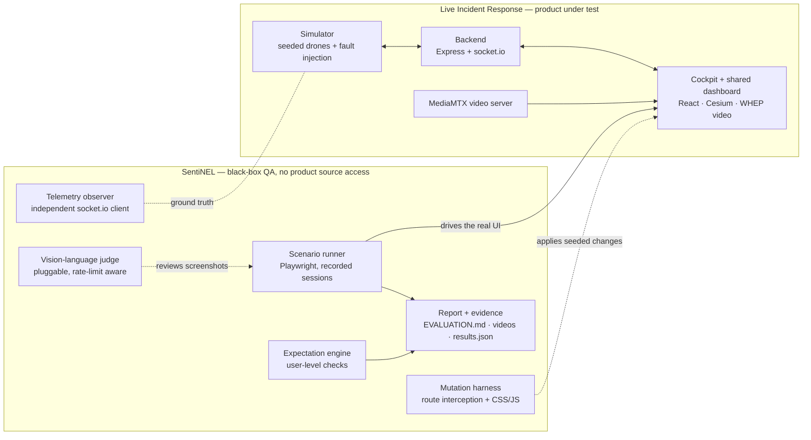
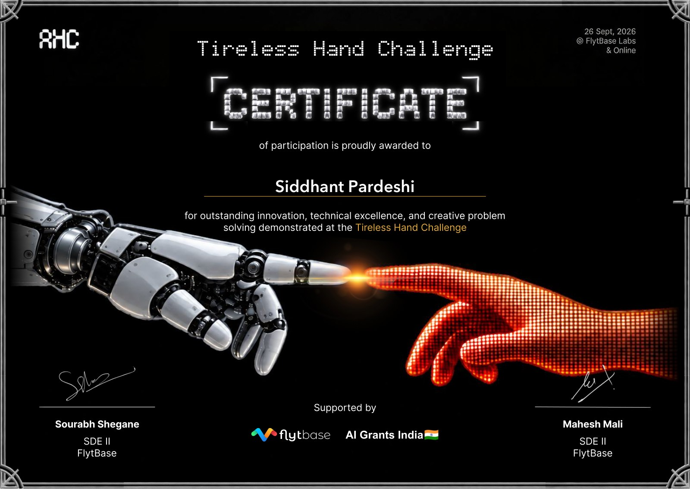

<div align="center">

# SentiNEL

**Agentic, black-box QA for a live drone incident-response dashboard**

*The Tireless Hand Challenge* — Agentic Software Testing · FlytBase Labs × AI Grants India · 26 Sept 2026

[](https://playwright.dev)
[](https://www.typescriptlang.org)
[](docs/EVALUATION.md)
[](docs/EVALUATION.md#12-mutation-validation-catching-deliberate-app-changes)

[Full evaluation write-up](docs/EVALUATION.md) · [Evidence Drive folder](https://drive.google.com/drive/folders/1zScppxBViCQ4jaNEU89lUIFVGiVV12l7?usp=sharing) · [Certificate](#recognition)

</div>

---

## What this is

SentiNEL tests a running product the way a responder would: through a real browser, judging behaviour by meaning, and returning reproducible evidence — a screen recording, screenshots and a check log for every finding. It never reads product source code and never runs unit tests.

- **Real multi-user sessions** — Playwright drives Chromium, one recorded session per human in the story (commander, responders, a phone). Sign-ins, joins, chat, drone commands are real UI interactions, not API stubs.
- **Independent telemetry observer** — a separate socket.io client listening to the simulator directly is the ground truth. Whatever the UI displays about drones is cross-checked against what devices actually published, so a screen that shows data nobody sent — or hides data that was sent — is caught without trusting the app.
- **Deterministic expectation engine** — product-level expectations written from the user's point of view ("status pill reaches in_flight", "freshness badge downgrades to delayed under a slow network"), checked via stable test ids and in-page measurement (bounding boxes, canvas pixel sampling of the video element, DOM state attributes).
- **Pluggable vision-language judge** — for semantic checks that resist exact assertions ("does this screen look right?"), screenshots are reviewed by any OpenAI-compatible vision endpoint. Rate-limit aware; its findings merge with the deterministic layer and never overrule a passing deterministic check.
- **Mutation harness** — the brief's example mutations are applied to the running app from outside (route interception, injected CSS/JS — no product code touched), and each paired detector must catch it. The same detectors run against the clean build to prove they stay silent.

**Product under test.** The starter FlytBase cockpit extended into *Live Incident Response*: email + OTP sign-in, incident create, secure joining links, a shared dashboard (participants with live presence, drones with telemetry/video/freshness, chat with replies and mentions, shared map observations), fault-visible data freshness, and a read-only audit history after the incident ends.

## Results

| | |
|---|---|
| Behavioural scenarios | **11/11 correct** — 60/60 deterministic checks passed |
| Mutation validation | **4/4 seeded mutations caught · 0 false positives** on the clean build |
| Real product defects found | **2** — both fixed and now regression-checked by their scenarios |
| Evidence | per-scenario screen recording + screenshots + check log |

<details>
<summary>The two real defects the system caught in the product (and their fixes)</summary>

1. **Signed-in users were bounced back to sign-in on every page reload** — the session was restored from storage in a React effect, but the auth guard redirected on the first render (a one-tick race). Fix: restore the session synchronously before the first render. Scenario 1 now asserts "session survives a reload" on every run.
2. **The dashboard overflowed horizontally at phone width** — grid children defaulted to content width, so the chat input rendered 549px wide inside a 390px viewport and pushed header actions off screen. Fix: `min-width: 0` on grid children plus a wrapping header. Scenario 8 now asserts zero horizontal overflow on both screens.

</details>

## Architecture



## Repo layout

| Path | What it is |
|---|---|
| [`tester/`](tester/README.md) | **SentiNEL** — the agentic QA system: runner, observer, expectation engine, vision judge, mutation harness, report generator |
| [`frontend/`](frontend/README.md) | Live Incident Response cockpit — React 18 + Vite + Cesium |
| [`backend/`](backend/README.md) | Express + socket.io: telemetry fan-out, control API, fault injection, MediaMTX stream management |
| [`simulator/`](simulator/README.md) | Deterministic drone/dock telemetry simulator (seeded RNG, fault-injection surface) |
| [`protocol/`](protocol/) | Shared typed message protocol |
| [`video/`](video/README.md) | MediaMTX (WHEP/RTSP) video server + sample clips |
| [`docs/`](docs/) | Full evaluation write-up, reference notes, participation certificate |

## Run it

**1. Start the product** (either mode):

```bash
# dev mode — what the evaluation used: cockpit on :5173, API on :4000
npm install
npm run dev

# or docker: cockpit on :4010, control panel on :4000/dashboard
docker compose up --build
```

**2. Run the QA system:**

```bash
cd tester
npm install
npm test        # resets product state, runs all scenarios + mutations → tester/evaluation/
```

Optional — enable the vision judge (any OpenAI-compatible endpoint) and/or point at the docker cockpit:

```bash
APP_URL=http://localhost:4010 \
JUDGE_API_KEY=… JUDGE_BASE_URL=https://integrate.api.nvidia.com/v1 \
JUDGE_MODEL=meta/llama-3.2-90b-vision-instruct npm test
```

Outputs land in `tester/evaluation/`: the regenerated write-up (`EVALUATION.md`), raw `results.json`, and `evidence/<scenario>/` screen recordings (.webm + .mp4) and screenshots.

## Documentation

- **[docs/EVALUATION.md](docs/EVALUATION.md)** — the full submission write-up: system design, all 12 scenarios with per-check evidence, mutation validation table, real defects found
- [tester/README.md](tester/README.md) — tester internals
- [docs/reference.md](docs/reference.md) — settings and reference notes for the product

## Recognition

Certificate of participation — *for outstanding innovation, technical excellence, and creative problem solving demonstrated at the Tireless Hand Challenge* (FlytBase Labs × AI Grants India, 26 Sept 2026):

<p align="center">
  <a href="docs/certificate/Siddhant-Pardeshi-Tireless-Hand-Challenge-Certificate.pdf">
    
  </a>
</p>

---

Built by [Siddhant Pardeshi](https://github.com/siddhant-pardeshi)
